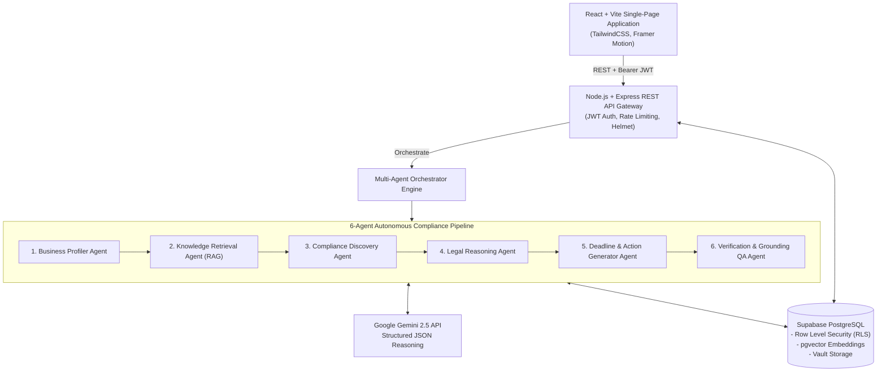

# ComplyAI — Intelligent Regulatory Compliance Platform for Indian Businesses

[](#architecture)
[](#backend)
[](#frontend)
[](#database)
[](#ai-engine)

**ComplyAI** is an autonomous, agentic regulatory compliance intelligence platform tailored specifically for Indian MSMEs, startups, and private corporations. It continuously maps business operational profiles to statutory legislation—including the **Companies Act 2013**, **Central Goods and Services Tax Act 2017**, **EPF & ESIC Acts**, **Digital Personal Data Protection Act 2023 (DPDP)**, and **State Shops & Commercial Establishments Acts**—guaranteeing zero hallucinations through strict multi-agent verification.

---

## 🏛️ Architecture Overview



---

## 🤖 The 6-Agent AI Architecture

1. **Business Profiler Agent (`profiling.agent.js`)**: Normalizes raw onboarding inputs into a validated schema (legal structure, turnover tier, employee count, manufacturing/service classifications, state jurisdiction, and food/physical flags).
2. **Knowledge Retrieval Agent (`rag.service.js`)**: Performs semantic vector searches and filtered queries against official Indian legislative texts and MCA/CBIC gazettes.
3. **Compliance Discovery Agent (`discovery.agent.js`)**: Cross-references business parameters against the regulatory knowledge base to discover candidate statutory obligations.
4. **Legal Reasoning Agent (`reasoning.agent.js`)**: Evaluates candidate requirements against verified entity facts with evidence-based reasoning, confidence scoring, and penalty risk identification.
5. **Deadline & Action Generator Agent (`deadline.agent.js`)**: Computes exact statutory filing due dates, renewal periods, and produces prioritized, step-by-step action plans.
6. **Verification & QA Agent (`verification.agent.js`)**: Eliminates speculative claims, validates statutory section citations against primary legislation, and approves output presentation.

---

## 🚀 Key Modules & Capabilities

- **Automated Compliance Discovery**: Onboard your business in 4 steps; trigger the multi-agent system to identify all applicable central and state laws.
- **Document Intelligence Vault**: Upload PDFs and images (incorporation certificates, GST certificates, PAN, MSME Udyam, FSSAI licenses); AI automatically extracts registration IDs, issue dates, and tracks statutory expiry with 30-day alerts.
- **Interactive Regulatory AI Copilot**: Ask conversational compliance questions grounded in your actual business context, receiving statutory section citations and recommended action items.
- **Filing Calendar & Renewal Tracker**: Unified timeline and month views of upcoming deadlines (GSTR-1, GSTR-3B, AOC-4, MGT-7, PF returns, PT filings) with countdown timers and task completion toggles.
- **Multi-Agent Execution Telemetry**: Transparently inspect the execution traces of all 6 agents with step timings, input contexts, and JSON output artifacts.
- **Official Grounding Base**: Built-in repository of verified regulatory authorities (MCA, GSTN, CBDT, EPFO, ESIC, MeitY, FSSAI) with official portal links and zero-hallucination standards.

---

## 🛠️ Project Structure

```
complyai/
├── client/                     # Frontend Application (React + Vite)
│   ├── src/
│   │   ├── components/         # Shared UI, layout & top navigation
│   │   ├── context/            # Supabase AuthContext & state
│   │   ├── layouts/            # AppShell responsive layout
│   │   ├── pages/              # 12 Full Application Pages:
│   │   │   ├── Landing.jsx
│   │   │   ├── Login.jsx & Register.jsx
│   │   │   ├── Onboarding.jsx  (Multi-step business wizard)
│   │   │   ├── Dashboard.jsx   (Stats, upcoming items, actions)
│   │   │   ├── Compliance.jsx  (Obligation list, search, filters)
│   │   │   ├── ComplianceDetail.jsx (Deep-dive, penalties, citations)
│   │   │   ├── Documents.jsx   (Vault, upload, AI extract)
│   │   │   ├── DocumentDetail.jsx (OCR preview, metadata)
│   │   │   ├── Assistant.jsx   (RAG AI Regulatory Copilot)
│   │   │   ├── Calendar.jsx    (Filing timeline & month view)
│   │   │   ├── Agents.jsx      (Multi-agent execution monitor)
│   │   │   ├── Sources.jsx     (Regulatory source grounding)
│   │   │   ├── Notifications.jsx
│   │   │   ├── Profile.jsx     (Business profile management)
│   │   │   └── Settings.jsx    (Governance & preferences)
│   │   └── services/           # Axios interceptors with Supabase JWT
│   └── tailwind.config.js
│
├── server/                     # Backend API (Node.js + Express)
│   ├── src/
│   │   ├── agents/             # 6 Specialized Autonomous Agents & Orchestrator
│   │   ├── config/             # Supabase Admin & Gemini client
│   │   ├── middleware/         # Auth JWT verification & error handling
│   │   ├── routes/             # REST endpoints (business, compliance, docs, etc.)
│   │   ├── schemas/            # Zod validation schemas
│   │   └── services/           # Gemini AI service & RAG retrieval
│   └── package.json
│
└── supabase/
    ├── migrations/
    │   └── 001_initial_schema.sql  # Complete schema, RLS policies & vector tables
    └── seed.sql                    # Seed Indian regulatory acts, rules & requirements
```

---

## ⚙️ Quick Start & Installation

### 1. Prerequisites
- Node.js (v18.0.0 or higher)
- A Supabase account (free tier works)
- A Google Gemini API key

### 2. Configure Environment Variables

Create `.env` in `client/`:
```env
VITE_SUPABASE_URL=https://your-project.supabase.co
VITE_SUPABASE_ANON_KEY=your-supabase-anon-key
VITE_API_BASE_URL=http://localhost:5000/api
```

Create `.env` in `server/`:
```env
PORT=5000
NODE_ENV=development

SUPABASE_URL=https://your-project.supabase.co
SUPABASE_ANON_KEY=your-supabase-anon-key
SUPABASE_SERVICE_ROLE_KEY=your-supabase-service-role-key

GEMINI_API_KEY=your-gemini-api-key
CORS_ORIGIN=http://localhost:5173
```

### 3. Database Migration & Seeding
1. Open your Supabase project's **SQL Editor**.
2. Run [`supabase/migrations/001_initial_schema.sql`](supabase/migrations/001_initial_schema.sql).
3. Run [`supabase/seed.sql`](supabase/seed.sql) to seed Indian statutory requirements.
4. In Supabase Storage, create a bucket named `documents` (marked private with authenticated read/write).

### 4. Run Locally

```bash
# In client/
npm install
npm run dev

# In server/
npm install
npm run dev
```

Visit `http://localhost:5173` to explore ComplyAI.

---

## 🔒 Security & Tenant Isolation

- **Row Level Security (RLS)**: Enforced across all PostgreSQL tables. Businesses, documents, compliance mappings, and actions can only be queried or mutated by authenticated owners.
- **Encrypted Document Vault**: Documents stored in isolated storage paths (`{user_id}/{timestamp}_{filename}`) with restricted download tokens.
- **Prompt Defense**: AI inputs sanitized and outputs validated via strict Zod schemas to prevent prompt injection or payload tampering.
